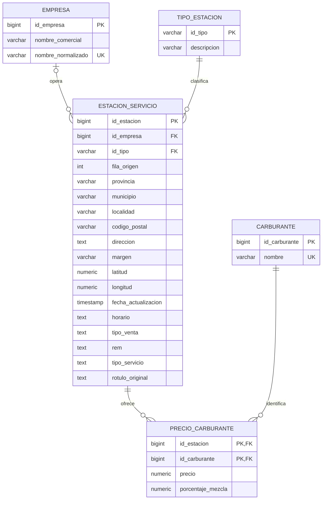

# Modelo entidad-relación propuesto

## Justificación

- **Cinco tablas**: `EMPRESA`, `TIPO_ESTACION`, `ESTACION_SERVICIO`, `CARBURANTE` y `PRECIO_CARBURANTE`.
- Una empresa puede operar muchas estaciones; una estación puede carecer de empresa identificada.
- Cada estación es terrestre o marítima; los precios son registros separados por carburante.
- La clave compuesta de `PRECIO_CARBURANTE` impide dos precios simultáneos del mismo carburante en una estación.
- Provincia, municipio y localidad se conservan como atributos de estación para simplificar este laboratorio; son campos repetidos y podrían normalizarse más en un modelo ampliado.
- `fila_origen` conserva trazabilidad con los archivos depurados, sin deduplicar erróneamente estaciones que comparten dirección.
- `fecha_actualizacion` queda NULL en marítimas porque el fichero limpio no trae fecha por poste.
- `Rótulo` se interpreta como **nombre comercial**, no como razón social acreditada.
- La búsqueda de 10 km usa distancia geodésica aproximada, no itinerario por carretera.
